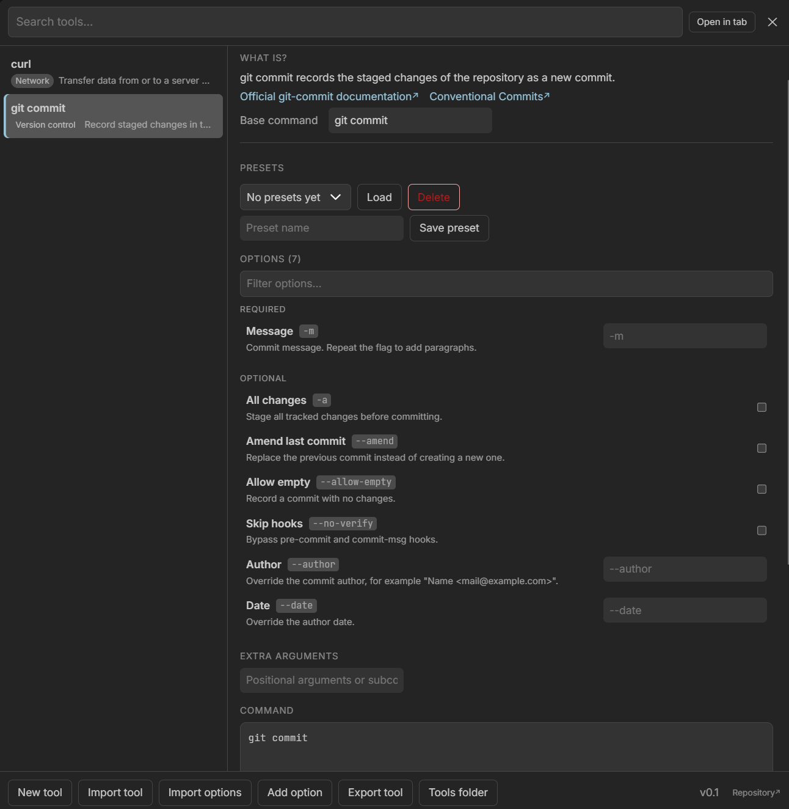
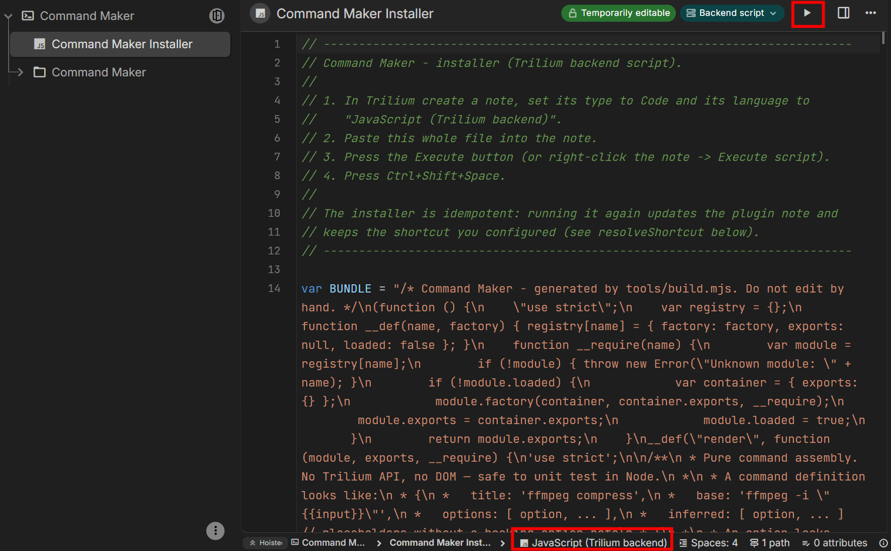
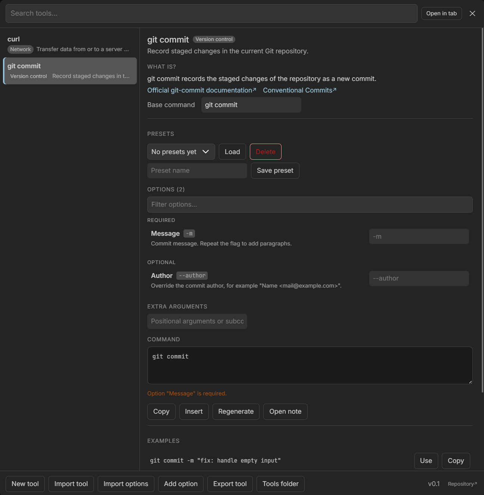
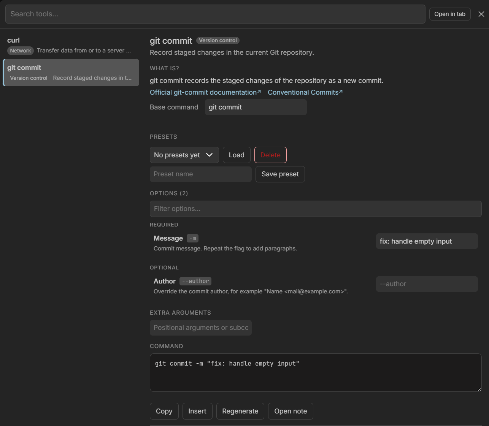
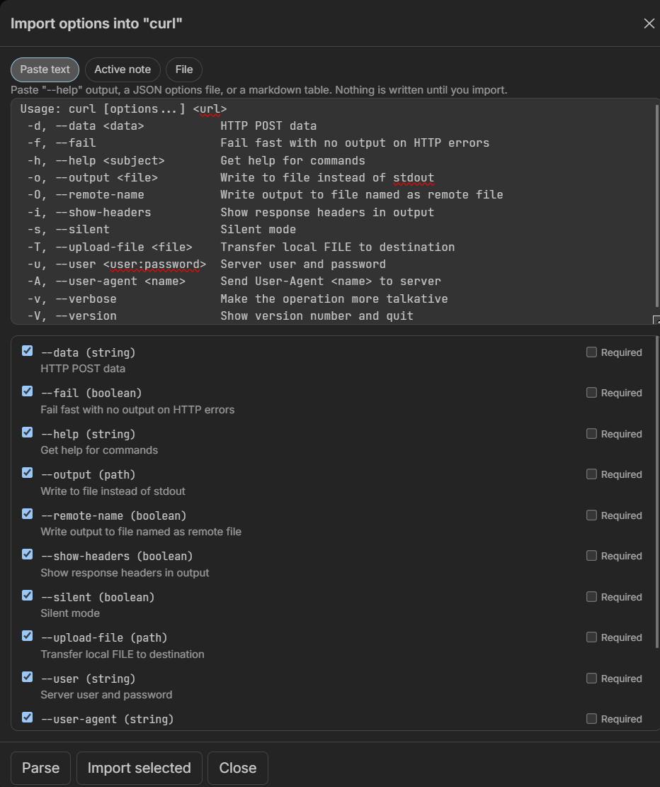

# Command Maker para Trilium

**Idioma:** Español · [English](README.md)

Un plugin de TriliumNext que convierte tus notas de herramientas CLI en una paleta de comandos. Busca una herramienta, lee qué hace, rellena sus opciones documentadas y obtén un comando listo para ejecutar que puedes editar, copiar, insertar o guardar como preset.

```
Ctrl+Shift+Space  →  busca una herramienta  →  lee la ayuda  →  rellena opciones  →  comando  →  copiar / insertar
```



## Instalación

Descarga `install.js` de la [última versión](https://github.com/J0nan/Trilium-Command-Maker-Plugin/releases/latest/download/install.js): no lo copies del repositorio, es un artefacto de compilación.

1. En Trilium, crea una nota de tipo **Code** e idioma **JavaScript (Trilium backend)**.
2. Pega dentro todo el contenido de `install.js`.
3. Pulsa el botón **Execute** de la nota.
4. Pulsa `Ctrl+Shift+Space`.



El instalador es idempotente. Crea la nota de ajustes `Command Maker`, la carpeta de datos `Tools` y el runtime del plugin, y registra el lanzador `Ctrl+Shift+Space`. La primera apertura siembra dos ejemplos: `git commit` y `curl`.

## Qué hace

- **Una paleta para tus notas de CLI.** `Ctrl+Shift+Space` abre una lista buscable de las herramientas que hayas documentado, con la ruta de sus carpetas (`Infraestructura / Wifi`).
- **La documentación donde la necesitas.** Cada nota de herramienta mantiene una sección *¿Qué es?* y secciones para los enlaces oficiales y la salida de instalación, uso y `--help`.
- **Opciones, no flags memorizados.** Cada opción es una nota con un flag, un texto de ayuda y un tipo, así que la paleta muestra el control correcto: texto, ruta, número, booleano o enumeración.
- **Un comando en el que puedes confiar.** La vista previa ensambla el comando base, los argumentos extra y los flags seleccionados en orden, los entrecomilla para un shell POSIX y te deja copiarlos, insertarlos en el editor o guardarlos como preset.
- **Importa en lugar de reescribir.** Pega la salida de `--help`, JSON o una tabla markdown y revisa cada opción detectada antes de que se escriba nada. Las herramientas completas entran y salen como un único archivo JSON.
- **Funciona como pestaña.** **Abrir en pestaña** mueve la misma interfaz junto a tus notas en lugar de encima de ellas.
- **Inglés y español.** La interfaz está traducida al inglés y al español de España. El menú de versión del pie permite cambiarla (ver [Cambiar el idioma](#cambiar-el-idioma)); la elección se guarda en la etiqueta `cmLang` de la nota de ajustes y se aplica al instante.

## Cambiar el idioma

1. Abre la paleta con `Ctrl+Shift+Space`.
2. Pulsa la píldora de versión del pie (`v1.0 ▾`).
3. Elige **English** o **Español**. Ese mismo menú incluye **Buscar actualizaciones**.

La elección se aplica al momento y se guarda en la etiqueta `cmLang` de la nota de ajustes `Command Maker`. Puedes poner esa etiqueta a mano (`en` o `es`) para arrancar en un idioma antes de la primera apertura. Sin etiqueta, el plugin sigue el idioma de Trilium/navegador y recurre al inglés. Las notas que ya existen conservan el idioma con el que se escribieron.

## Capturas



*La descripción, el texto de **¿Qué es?** y los enlaces salen de la propia nota de la herramienta; las opciones se leen de las notas que hay dentro de su carpeta `Options`, agrupadas en **Obligatorias** y **Opcionales**, con un aviso hasta que una obligatoria tiene valor.*



*Rellenar una opción regenera el comando: aquí `-m` y el mensaje se entrecomillan para el shell. **Copiar**, **Insertar** y **Abrir nota** actúan sobre el resultado.*



*Pega `curl --help`, JSON o una tabla markdown, revisa cada opción detectada y su tipo, e importa solo las que quieras.*

## Documentación completa

[`docs/guide.md`](docs/guide.md) cubre todo lo demás (en inglés):

- [Install](docs/guide.md#install): desinstalación, atajos personalizados, modo pestaña, instalación manual.
- [Structure](docs/guide.md#structure): el árbol `Tools`, las notas de herramienta, las tres notas hijas estándar, todos los atributos de una opción, el ensamblado del comando y los presets.
- [Importing options](docs/guide.md#importing-options): `--help`, JSON y tablas markdown, con el límite de 200 opciones.
- [Importing and exporting whole tools](docs/guide.md#importing-and-exporting-whole-tools): el formato de archivo `version: 2` y el prompt de IA que lo genera.
- [Limitations](docs/guide.md#limitations): entrecomillado del shell, heurísticas del análisis de `--help` y árboles grandes.

## Desarrollo

```bash
npm run build     # src/ → dist/command-maker.js + dist/install.js
npm test          # tests unitarios de modelo, parser, secciones, render, backend y UI
npm run check     # ambos
```

Sin dependencias, Node 20 o superior. Las notas de versión y diseño están en la [guía](docs/guide.md#releasing) (en inglés).

## Licencia

GNU General Public License v3.0 o posterior. El texto completo se incluye en [LICENSE](LICENSE).