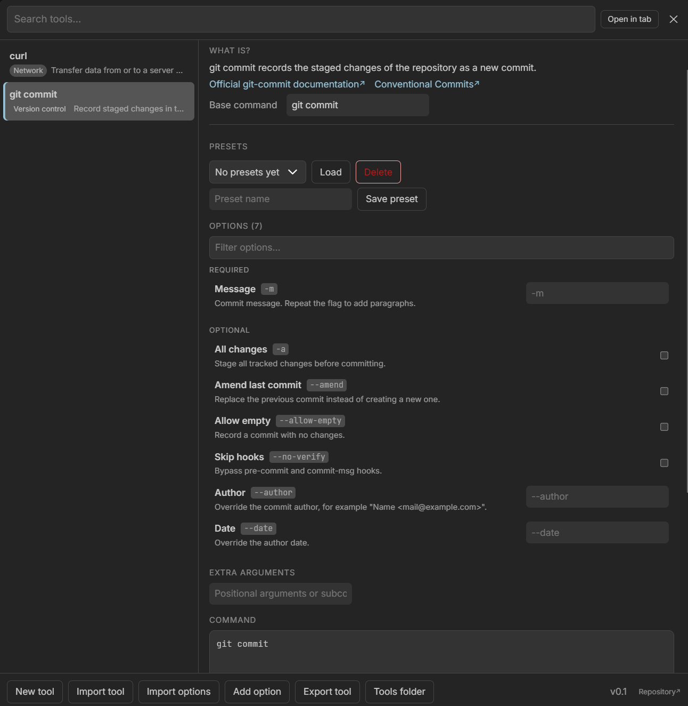
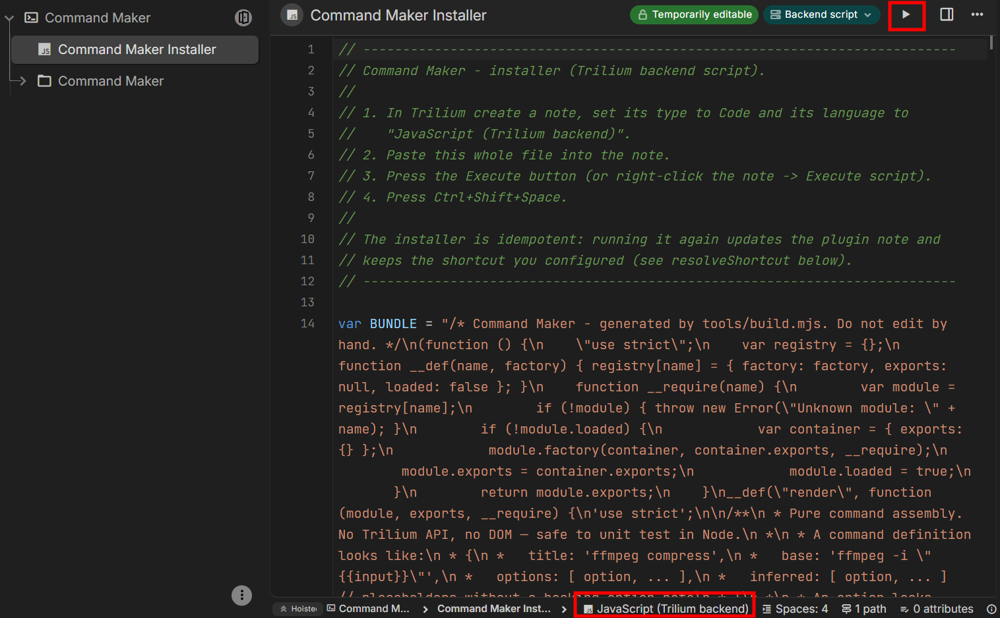
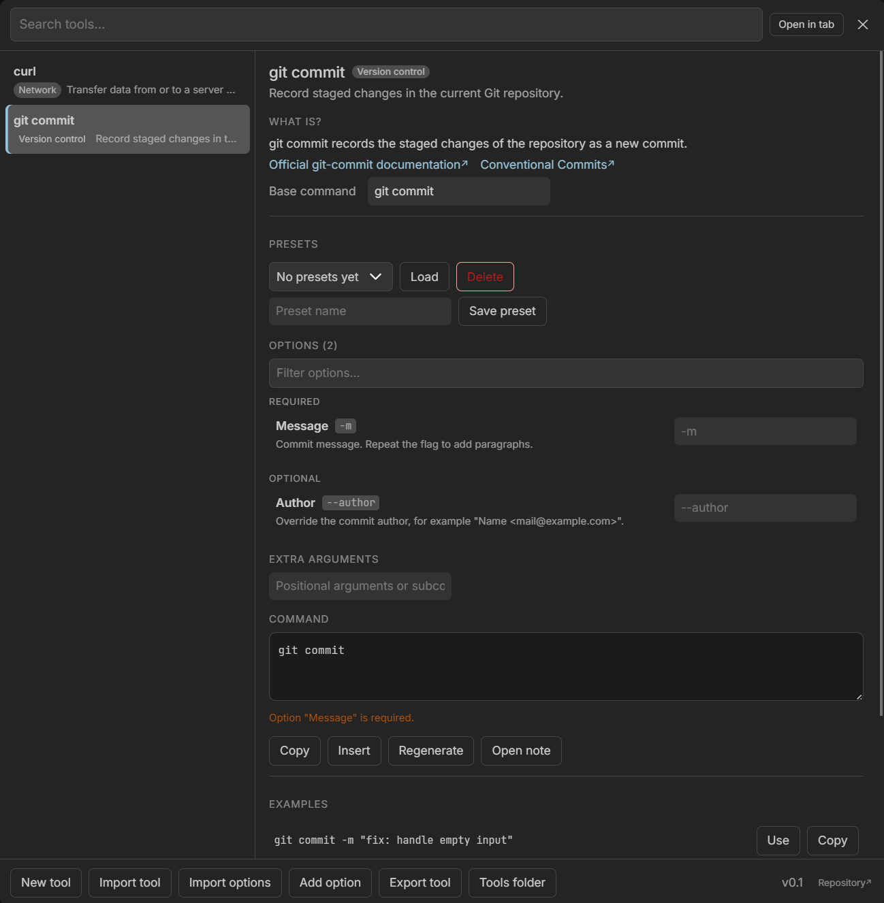
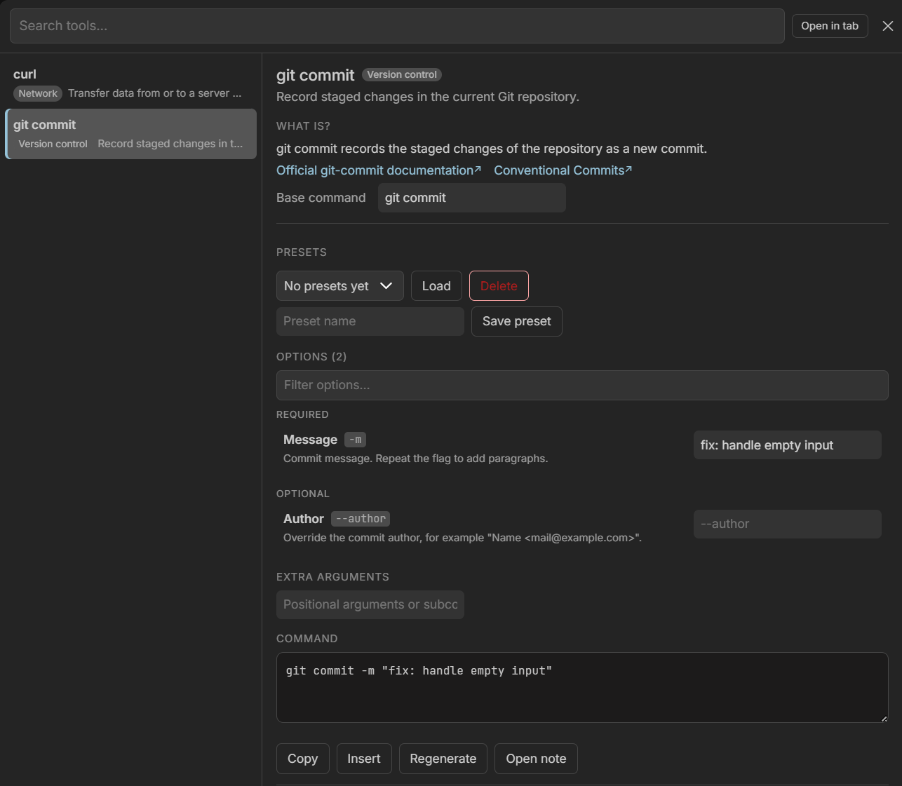
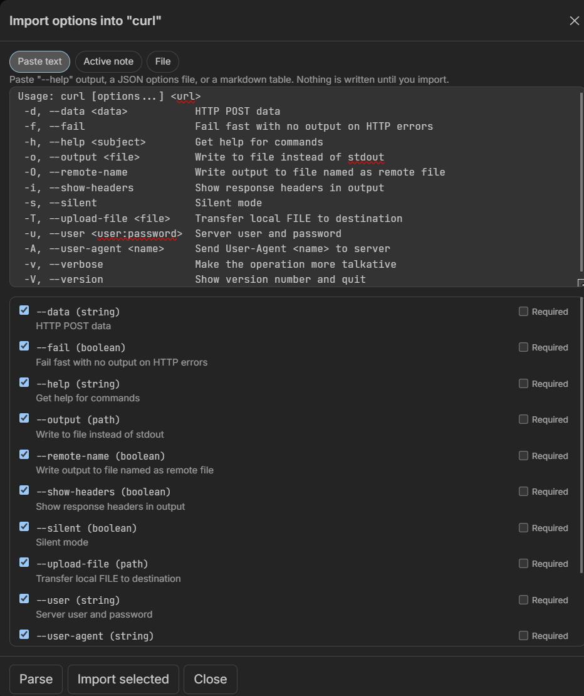

# Command Maker for Trilium

**Language:** English · [Español](README.es.md)

A TriliumNext plugin that turns your CLI tool notes into a command palette. Search a tool, read what it does, fill in its documented options, and get a runnable command you can edit, copy, insert, or save as a preset.

```
Ctrl+Shift+Space  →  search a tool  →  read help  →  fill options  →  command  →  copy / insert
```



## Install

Get `install.js` from the [latest release](https://github.com/J0nan/Trilium-Command-Maker-Plugin/releases/latest/download/install.js): do not copy it out of the repository, it is a build artifact.

1. In Trilium, create a note with type **Code** and language **JavaScript (Trilium backend)**.
2. Paste the whole content of `install.js` into it.
3. Press the note's **Execute** button.
4. Press `Ctrl+Shift+Space`.



The installer is idempotent. It creates the `Command Maker` settings note, the `Tools` data folder and the plugin runtime, and registers the `Ctrl+Shift+Space` launcher. The first open seeds two examples: `git commit` and `curl`.

## What it does

- **A palette for your CLI notes.** `Ctrl+Shift+Space` opens a searchable list of the tools you documented, with categories.
- **Docs where you need them.** Each tool note keeps a *What is?* section plus sections for the official links and the install, usage and `--help` output.
- **Options, not memorised flags.** Each option is a note with a flag, help text and a type, so the palette renders the right control: text, path, number, boolean or enum.
- **A command you can trust.** The preview assembles base, extra arguments and selected flags in order, quotes them for a POSIX shell, and lets you copy, insert into the editor or save as a preset.
- **Import instead of retyping.** Paste `--help` output, JSON or a markdown table and preview every detected option before anything is written. Whole tools move in and out as one JSON file.
- **Works as a tab.** **Open in tab** moves the same interface next to your notes instead of over them.
- **English and Spanish.** The interface is translated into English and Spain Spanish. Pick the language in the footer selector; the choice is stored in the `cmLang` label of the settings note and applies immediately.

## Screenshots



*The description, the **What is?** text and the links come from the tool's own note; options are read from the notes under its `Options` folder, grouped into **Required** and **Optional**, with a warning until a required one has a value.*



*Filling an option regenerates the command: here `-m` and the message are quoted for the shell. **Copy**, **Insert** and **Open note** act on the result.*



*Paste `curl --help`, JSON or a markdown table, review every detected option and its type, and import only the ones you want.*

## Full documentation

[`docs/guide.md`](docs/guide.md) covers everything else:

- [Install](docs/guide.md#install): uninstall, shortcut overrides, tab mode, manual install.
- [Structure](docs/guide.md#structure): the `Tools` tree, tool notes, the three standard children, every option attribute, command assembly and presets.
- [Importing options](docs/guide.md#importing-options): `--help`, JSON and markdown tables, with the 200-option bound.
- [Importing and exporting whole tools](docs/guide.md#importing-and-exporting-whole-tools): the `version: 2` file format and the AI prompt that generates it.
- [Limitations](docs/guide.md#limitations): shell quoting, `--help` parsing heuristics and large trees.

## Development

```bash
npm run build     # src/ → dist/command-maker.js + dist/install.js
npm test          # unit tests for model, parser, sections, renderer, backend, UI
npm run check     # both
```

No dependencies, Node 20+. Release and design notes live in the [guide](docs/guide.md#releasing).

## License

GNU General Public License v3.0 or later. The full text ships in [LICENSE](LICENSE).